<!--
  Profile README for titan717.
  Visual direction: midnight ink, soft violet, a little playful Panda energy.
-->

  

  

    <a href="https://github.com/titan717?tab=repositories">projects</a>
    &nbsp;·&nbsp;
    <a href="https://github.com/titan717/Panda.fun">Panda.fun</a>
    &nbsp;·&nbsp;
    <a href="https://github.com/titan717/titanembed">Titan Embed</a>
  

---

I like building products where the details matter — the little transitions, the awkward edge cases, the way an interface feels with a TV remote in your hand.

Most of my work sits around apps, playback, and the systems behind them. I tend to build, test, pull things apart, and polish them until they feel right.

## The big one at the moment

  
   
  <strong><a href="https://github.com/titan717/Panda.fun">Panda.fun</a></strong>
   
  A little panda, a lot of engineering.

Panda.fun is an entertainment app for **Android TV, phones, tablets, and the web**. One codebase adapts to touch or a D-pad, with a dedicated TV experience rather than a stretched mobile layout.

A few things I care about in it:
- TV navigation that feels natural with a remote
- Mobile layouts that feel made for touch
- A player experience that remembers where you left off
- Profiles, watch lists, discovery, and the small bits of polish around them

  
  
   
  TV and mobile — same product, different ways to use it.

## Other things on my workbench

| Project | What it is |
|:--|:--|
| [Titan Embed](https://github.com/titan717/titanembed) | An adaptive video player with a remote-first TV interface and a touch-first mobile player. |
| [MovieAPI](https://github.com/titan717/movieapi) | The service layer behind Panda.fun — metadata, discovery, trailers, and playback integration. |
| [ANIMORA](https://github.com/titan717/titan717.github.io) | An anime and manga discovery interface. |
| [InvStock](https://github.com/titan717/invstock) | A stock-market simulator. |
| [ReAnime.to API](https://github.com/titan717/ReAnime.to-API) | An API project for ReAnime.to. |

## Tools I reach for

  

I work across **React, TypeScript, JavaScript, Node.js, and Kotlin**, depending on what the project needs.

---

  
   
  Thanks for stopping by. Have a lovely day. 🐼
    
  <a href="https://github.com/titan717">github.com/titan717</a>

